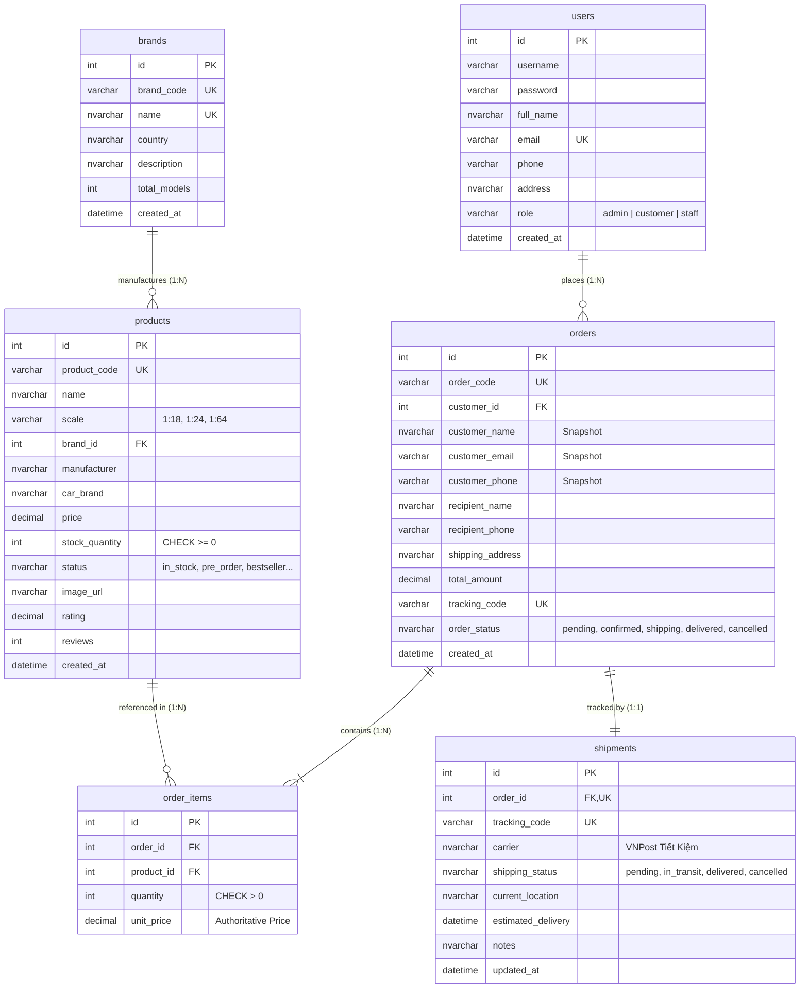
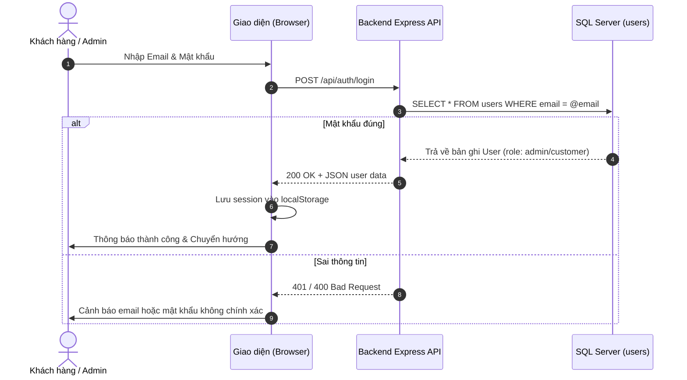
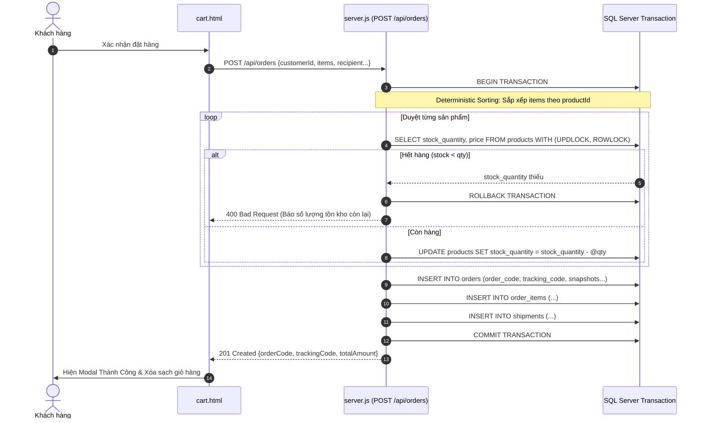

# 🏎️ CARMODEL STORE - HỆ THỐNG THƯƠNG MẠI ĐIỆN TỬ MÔ HÌNH XE Ô TÔ CAO CẤP
> **Môn học:** Lập trình Web & Ứng dụng Cơ sở Dữ liệu  
> **Kiến trúc hệ thống:** Client-Side Single Page & Multi-Page Hybrid + RESTful Node.js Backend + Microsoft SQL Server 2025  
> **Trạng thái:** Hoàn tất 100% tích hợp E2E, bảo đảm ACID Transactions, PII Masking, Multi-Driver SQL Singleton & Responsive UI/UX  

---

## 📑 MỤC LỤC
1. [Giới thiệu Khái quát về Dự án](#-1-giới-thiệu-khái-quát-về-dự-án)
2. [Cấu trúc Thư mục & Bản đồ Mã nguồn (Source Code Map)](#-2-cấu-trúc-thư-mục--bản-đồ-mã-nguồn)
3. [Kiến trúc Cơ sở Dữ liệu & Sự Liên kết (Database Architecture & Relations)](#-3-kiến-trúc-cơ-sở-dữ-liệu--sự-liên-kết)
4. [Nguyên lý Hoạt động & Các Luồng Dữ liệu Nghiệp vụ (System Flow & E2E Lifecycle)](#-4-nguyên-lý-hoạt-động--các-luồng-dữ-liệu-nghiệp-vụ)
5. [Chi tiết các Tính năng Nghiệp vụ Lõi (Core Features & ACID Reliability)](#-5-chi-tiết-các-tính-năng-nghiệp-vụ-lõi)
6. [Hệ thống Phân quyền (RBAC) & Bảo mật](#-6-hệ-thống-phân-quyền-rbac--bảo-mật)
7. [Giao diện Người dùng & Chuẩn hóa Responsive UI/UX](#-7-giao-diện-người-dùng--chuẩn-hóa-responsive-uiux)
8. [Hướng dẫn Cài đặt & Vận hành Hệ thống](#-8-hướng-dẫn-cài-đặt--vận-hành-hệ-thống)
9. [Bộ Kiểm thử Tự động 4-Tier (Automated Test Suite)](#-9-bộ-kiểm-thử-tự-động-4-tier)
10. [Bảng Phân công Đóng góp của Thành viên](#-10-bảng-phân-công-đóng-góp-của-thành-viên)

---

## 🌟 1. GIỚI THIỆU KHÁI QUÁT VỀ DỰ ÁN

### 1.1. Bối cảnh & Tầm nhìn
**CarModel Store** là giải pháp phần mềm thương mại điện tử chuyên biệt dành cho người sưu tầm mô hình ô tô thu nhỏ tĩnh (Scale Diecast Cars) thuộc các tỉ lệ tiêu chuẩn thế giới: **1:18**, **1:24**, và **1:64**.

Ứng dụng đáp ứng trọn vẹn 2 góc nhìn người dùng:
1. **Khách hàng (Client/Customer Portal):** Trải nghiệm xem xe mô hình 360°, lọc sản phẩm theo hãng/tỉ lệ/mức giá, đặt trước các mẫu xe giới hạn (Pre-order), đặt hàng trực tuyến với kiểm tra tồn kho theo thời gian thực (Real-time Stock Checking), quản lý lịch sử đơn hàng và tra cứu hành trình vận chuyển VNPost qua mã vận đơn (Parcel Tracking).
2. **Quản trị viên (Admin Portal):** Quản lý toàn bộ danh mục sản phẩm, theo dõi 4 chỉ số KPI cốt lõi (Doanh thu, tổng số xe, số đơn hàng, số thương hiệu), xét duyệt và cập nhật trạng thái đơn hàng thông qua máy trạng thái 2 chiều (Bidirectional State Machine) tự động hoàn trả tồn kho khi hủy đơn.

### 1.2. Công nghệ Nền tảng (Tech Stack)
* **Frontend:**
  - Vanilla HTML5 Semantic (`<header>`, `<nav>`, `<main>`, `<article>`, `<section>`, `<aside>`, `<footer>`).
  - CSS3 Luxury Design Tokens (Bảng màu *Midnight Charcoal*, *Platinum Silver* và điểm nhấn *Gold Metallic*).
  - Flexbox, CSS Grid Responsive Layout (Mobile, Tablet, Desktop).
  - Vanilla JavaScript ES6+, Web Storage (`localStorage`), Module hóa API fetcher (`assets/js/config.js`).
* **Backend:**
  - **Node.js** (hỗ trợ native Node.js v20 – v24).
  - **Express 5** RESTful Framework, CORS Middleware.
  - Hỗ trợ triển khai linh hoạt: Localhost Server truyền thống và Vercel Serverless Function qua rewrite `/api/*`.
* **Cơ sở dữ liệu (Database):**
  - **Microsoft SQL Server** (2019/2022/2025 & Express Edition).
  - Drivers: `msnodesqlv8` (Windows Authentication kết nối local zero-config) và `mssql` pure TDS (hỗ trợ cloud/container).
  - Chuẩn hóa quan hệ 3NF, ràng buộc toàn vẹn khóa ngoại (Foreign Keys), ràng buộc kiểm tra (`CHECK`), chỉ mục không gom cụm (`NONCLUSTERED INDEX`) tối ưu tốc độ tra cứu.

---

## 📁 2. CẤU TRÚC THƯ MỤC & BẢN ĐỒ MÃ NGUỒN

```text
d:\laptrinhweb - Copy\
│
├── 🌐 GIAO DIỆN KHÁCH HÀNG (PUBLIC STORE)
│   ├── index.html                   # Trang chủ: Hero banner slider 4 bộ sưu tập, xe bán chạy, preorder
│   ├── products.html                # Tất cả mô hình: Bộ lọc đa năng (hãng, tỉ lệ, giá), tìm kiếm, chế độ xem
│   ├── product-detail.html          # Chi tiết mô hình: Thông số diecast, giá, tồn kho realtime, thêm giỏ hàng
│   ├── accessories.html             # Phụ kiện trưng bày: Hộp mica, sa bàn diorama, đèn LED, đế xoay
│   ├── brands.html                  # Danh bạ các thương hiệu siêu xe đối tác (Ferrari, Lamborghini, Porsche...)
│   ├── brand-detail.html            # Bộ sưu tập chuyên sâu theo từng hãng xe (tiêu biểu: Ferrari Collection)
│   ├── preorder.html                # Trang đặt trước các mẫu xe giới hạn sắp ra mắt
│   ├── cart.html                    # Giỏ hàng & Modal thanh toán: Đồng bộ đơn giá DB, kiểm tra tồn kho
│   ├── wishlist.html                # Danh sách xe yêu thích cá nhân (lưu trữ theo LocalStorage)
│   ├── contact.html                 # Liên hệ showroom & Tính năng tra cứu hành trình vận đơn (Tracking)
│   ├── login.html                   # Đăng nhập hệ thống (hỗ trợ nút điền nhanh cho Giảng viên / Quản trị viên)
│   ├── register.html                # Đăng ký tài khoản khách hàng mới (lưu trực tiếp vào CSDL SQL Server)
│   └── account.html                 # Hồ sơ khách hàng & Bảng lịch sử các đơn hàng đã đặt
│
├── 🏢 PHÂN HỆ QUẢN TRỊ VIÊN (ADMIN PORTAL - /admin/)
│   ├── admin/dashboard.html         # Bảng điều khiển KPI: Doanh thu thực tế, số xe, đơn hàng & 5 đơn mới nhất
│   ├── admin/products.html          # Quản lý kho xe: Tìm kiếm, lọc, phân trang, xóa sản phẩm
│   ├── admin/product-add.html       # Biểu mẫu nhập xe mô hình mới vào kho
│   ├── admin/brands.html            # Quản lý đối tác và thương hiệu
│   └── admin/orders.html            # Quản lý & Cập nhật trạng thái đơn hàng (modal duyệt đơn thời gian thực)
│
├── 🎨 TÀI NGUYÊN DÙNG CHUNG (/assets/)
│   ├── assets/css/style.css         # Hệ thống định kiểu toàn website (Luxury Theme, Responsive breakpoints)
│   ├── assets/css/admin.css         # Stylesheet chuyên dụng cho bảng điều khiển quản trị (Pure CSS Bar Chart)
│   ├── assets/js/config.js          # Bộ chuyển đổi API Base URL động (Localhost ↔ Vercel), apiFetch wrapper
│   ├── assets/js/main.js            # Xử lý giỏ hàng theo user, wishlist badge, auth state trên header
│   ├── assets/js/api.js             # Client renderer nạp sản phẩm động từ API cho trang chủ
│   └── assets/js/admin-auth.js      # Module bảo vệ đăng nhập RBAC, chặn khách vãng lai vào Admin
│
├── ⚙️ MÁY CHỦ BACKEND (/car-store-backend/ & /api/)
│   ├── car-store-backend/server.js  # Express Server: Chứa toàn bộ REST API, ACID Transactions, Connection Pool
│   ├── car-store-backend/migrate.js # Kịch bản kiểm tra & cập nhật cấu trúc bảng DB idempotent (Feature F2)
│   ├── car-store-backend/.env       # Biến môi trường kết nối cơ sở dữ liệu
│   ├── car-store-backend/.env.example # File mẫu hướng dẫn thiết lập biến môi trường
│   ├── api/index.js                 # Serverless Entry Point tương thích hạ tầng Vercel
│   └── vercel.json                  # Cấu hình định tuyến Serverless Functions
│
├── 🗄️ CƠ SỞ DỮ LIỆU SQL SERVER (/database/)
│   ├── database/00_full_setup.sql   # Kịch bản 1-Click: Tạo DB, tạo bảng, nạp hạt giống dữ liệu và truy vấn JOIN
│   ├── database/01_create_tables.sql# DDL định nghĩa 6 bảng quan hệ chuẩn 3NF, khóa ngoại, CHECK, UNIQUE
│   ├── database/02_insert_mock_data.sql # Hạt giống dữ liệu xe mô hình, người dùng và đơn hàng ban đầu
│   └── database/03_queries_and_reports.sql # Các câu lệnh JOIN 4-6 bảng lập báo cáo doanh thu
│
├── 🧪 BỘ KIỂM THỬ TỰ ĐỘNG E2E (/test/)
│   ├── test/test-runner.js          # Trình chạy test tự động 4 tầng (Native Node.js test runner)
│   ├── test/tier1-features.test.js  # Kiểm thử chức năng AC1 - AC7
│   ├── test/tier2-boundary.test.js  # Kiểm thử biên, số lượng âm, tồn kho cạn, đồng thời (concurrency)
│   ├── test/tier3-pairwise.test.js  # Kiểm thử kết hợp chéo các trạng thái
│   └── test/tier4-application.test.js # Kiểm thử trọn vẹn hành trình người dùng (User Journeys)
│
└── 📦 LƯU TRỮ ĐÓNG GÓP THÀNH VIÊN (/members_contributions/)
    ├── members_contributions/01_han_cart_and_auth/
    ├── members_contributions/02_mai_database_sql/
    ├── members_contributions/03_minh_navigation_and_accessories/
    └── members_contributions/05_long_admin_report/
```

---

## 🗄️ 3. KIẾN TRÚC CƠ SỞ DỮ LIỆU & SỰ LIÊN KẾT

Cơ sở dữ liệu được đặt tên chuẩn là **`CarModelStoreDB`** (hoặc `car_order_db`), thiết kế theo mô hình quan hệ chuẩn hóa bậc 3 (3NF) với 6 thực thể quan hệ mật thiết:



### 3.1. Phân tích chi tiết các Bảng và Mối liên kết

#### 1. Bảng `users` (Người dùng & Khách hàng)
- **Mục đích:** Lưu trữ tài khoản đăng nhập của cả Quản trị viên (`role = 'admin'`) và Khách hàng (`role = 'customer'`).
- **Liên kết:** Một người dùng có thể thực hiện nhiều đơn hàng (`users.id (1) ───< orders.customer_id (N)`).

#### 2. Bảng `brands` (Hãng sản xuất xe thật)
- **Mục đích:** Định danh thương hiệu gốc của các dòng siêu xe (Ferrari, Porsche, Lamborghini, Bugatti...).
- **Liên kết:** Một thương hiệu có nhiều mẫu mô hình (`brands.id (1) ───< products.brand_id (N)`).

#### 3. Bảng `products` (Kho mô hình xe)
- **Mục đích:** Quản lý kho xe chi tiết, bao gồm mã sản phẩm, tên, tỉ lệ kích thước, hãng sản xuất mô hình (Bburago, Maisto, AutoArt), đơn giá niêm yết và số lượng tồn kho khả dụng.
- **Ràng buộc quan trọng:** `CONSTRAINT CK_products_stock_quantity CHECK (stock_quantity >= 0)` ngăn chặn tuyệt đối lỗi âm kho dưới mọi hình thức giao dịch đồng thời.

#### 4. Bảng `orders` (Đơn đặt hàng)
- **Mục đích:** Ghi nhận thông tin tổng thể của giao dịch mua sắm.
- **Thiết kế Snapshot thông minh:** Ngoài liên kết khóa ngoại `customer_id` trỏ về bảng `users`, bảng `orders` lưu giữ các trường **Customer Snapshot** (`customer_name`, `customer_email`, `customer_phone`). Điều này đảm bảo khi người dùng chỉnh sửa thông tin cá nhân trong tương lai, hóa đơn chứng từ lịch sử vẫn giữ nguyên vẹn giá trị pháp lý tại thời điểm giao dịch.
- **Ràng buộc:** `tracking_code` mang ràng buộc duy nhất (`UNIQUE`), liên kết 1-1 với vận đơn chuyển phát.

#### 5. Bảng `order_items` (Chi tiết đơn hàng)
- **Mục đích:** Bảng trung gian giải quyết quan hệ nhiều-nhiều ($N:N$) giữa `orders` và `products`.
- **Authoritative Unit Price:** Cột `unit_price` lưu giá bán thực tế được Backend đọc trực tiếp từ CSDL tại thời điểm tạo đơn, không nhận giá do trình duyệt gửi lên nhằm triệt tiêu lỗ hổng gian lận giá ở Client-side.
- **Ràng buộc:** `ON DELETE CASCADE` tự động dọn dẹp các dòng chi tiết khi đơn hàng cha bị xóa khỏi hệ thống.

#### 6. Bảng `shipments` (Vận đơn & Hành trình bưu cục)
- **Mục đích:** Mô phỏng kết nối với hệ thống bưu chính (VNPost).
- **Liên kết:** Khóa ngoại `order_id` liên kết 1-1 chặt chẽ với `orders.id`.
- **Hành trình:** Quản lý vị trí hiện tại (`current_location`), ngày dự kiến giao (`estimated_delivery`), trạng thái vận chuyển (`shipping_status`) và nhật ký bưu tá (`notes`).

---

## 🔄 4. NGUYÊN LÝ HOẠT ĐỘNG & CÁC LUỒNG DỮ LIỆU NGHIỆP VỤ

### 4.1. Luồng Xác thực & Khởi tạo Phiên (Authentication Flow)
1. Khách hàng đăng ký tài khoản tại [`register.html`](file:///d:/laptrinhweb%20-%20Copy/register.html) $\rightarrow$ Gửi `POST /api/auth/register` $\rightarrow$ Backend kiểm tra tính duy nhất của email trong bảng `users` $\rightarrow$ Insert bản ghi vào CSDL.
2. Khách hàng/Admin đăng nhập tại [`login.html`](file:///d:/laptrinhweb%20-%20Copy/login.html) $\rightarrow$ Gửi `POST /api/auth/login` $\rightarrow$ Backend xác thực và trả về thông tin người dùng $\rightarrow$ Client lưu phiên vào `localStorage` (`cms_auth_user` và `carModelStoreCurrentUser`).
3. Toàn bộ các trang con tự động lắng nghe `DOMContentLoaded`: hàm `updateHeaderAuthState()` tự động biến đổi nút "Đăng nhập" thành lời chào cá nhân hóa (ví dụ: `👋 Quản trị viên (Admin)` hoặc `👋 Nguyễn Văn An`), đồng thời hiển thị shortcut điều hướng tương ứng.



---

### 4.2. Luồng Mua hàng & Giao dịch ACID (ACID Checkout Flow)
Đây là nghiệp vụ quan trọng nhất của hệ thống, bảo đảm 100% nguyên lý **ACID (Atomicity, Consistency, Isolation, Durability)**:

1. **Khách hàng** thêm mô hình vào giỏ hàng tại [`product-detail.html`](file:///d:/laptrinhweb%20-%20Copy/product-detail.html) $\rightarrow$ Giỏ hàng lưu trữ riêng biệt theo email người dùng trong `localStorage` (`cms_cart_{email}`).
2. Tại [`cart.html`](file:///d:/laptrinhweb%20-%20Copy/cart.html), khách hàng mở Modal Thanh toán, điền thông tin người nhận và nhấn "Gửi đơn hàng".
3. **Phía Server (`POST /api/orders`):**
   - **Bắt đầu Transaction:** `await transaction.begin()`.
   - **Deterministic Item Sorting:** Tự động sắp xếp mảng sản phẩm tăng dần theo `productId` (`[...items].sort((a,b) => a.productId - b.productId)`). Cơ chế này loại bỏ hoàn toàn hiện tượng **Deadlock** khi nhiều khách hàng cùng tranh chấp mua các sản phẩm giống nhau nhưng theo thứ tự giỏ hàng khác nhau.
   - **Khóa dòng độc quyền:** Thực hiện truy vấn đọc tồn kho với chỉ thị `WITH (UPDLOCK, ROWLOCK)` trên từng sản phẩm. Các giao dịch khác cố gắng cập nhật sản phẩm này sẽ phải chờ cho đến khi transaction kết thúc.
   - **Thẩm định tồn kho:** Nếu `availableStock < item.quantity`, hệ thống hủy bỏ giao dịch an toàn (`rollbackSafely()`) và báo lỗi chi tiết số lượng còn lại trong kho.
   - **Trừ kho tức thì:** `UPDATE products SET stock_quantity = stock_quantity - @qty WHERE id = @pid`.
   - **Tạo đơn hàng & Snapshot:** Chèn bản ghi vào bảng `orders` với mã đơn `ORD-...` và mã vận đơn `VNPOST-...`.
   - **Ghi chi tiết đơn hàng:** Ghi từng sản phẩm vào bảng `order_items` với đơn giá đọc từ CSDL.
   - **Khởi tạo vận đơn:** Tự động tạo bản ghi trong bảng `shipments` với trạng thái `pending`.
   - **Commit Transaction:** `await transaction.commit()`.



---

### 4.3. Luồng Quản lý Đơn hàng & Máy trạng thái Hai chiều (State Machine Flow)
Khi đơn hàng được xử lý, trạng thái di chuyển qua các giai đoạn:
$$\text{pending (Chờ xử lý)} \longrightarrow \text{confirmed (Đã xác nhận)} \longrightarrow \text{shipping (Đang giao)} \longrightarrow \text{delivered / completed (Hoàn thành)}$$

**Tính năng Đột phá: Hủy đơn Idempotent & Tự động Hoàn kho (Feature F4)**
- Nếu đơn hàng chuyển sang `cancelled` (do Quản trị viên hủy hoặc Khách hàng hủy):
  1. Transaction khóa dòng đơn hàng `WITH (UPDLOCK, ROWLOCK)`.
  2. Kiểm tra nếu đơn hàng vốn đã là `cancelled` $\rightarrow$ Từ chối xử lý, ngăn chặn lỗi double-cancel làm tăng khống số lượng hàng trong kho (**Stock Inflation**).
  3. Đọc danh sách các mặt hàng trong `order_items` và hoàn trả chính xác số lượng về kho:  
     `UPDATE products SET stock_quantity = stock_quantity + @qty WHERE id = @pid`.
  4. Đồng bộ trạng thái vận đơn `shipments.shipping_status = 'cancelled'`.
  5. Cập nhật `orders.order_status = 'cancelled'`.

---

### 4.4. Luồng Tra cứu Hành trình Vận đơn & Bảo vệ PII (Tracking API)
Khách hàng truy cập [`contact.html`](file:///d:/laptrinhweb%20-%20Copy/contact.html), nhập mã vận đơn (ví dụ `VNPOST-ORD-2026-0001` hoặc mã đơn hàng `ORD-...`):
1. Client gửi `GET /api/tracking/:code`.
2. Backend truy vấn kết hợp giữa `orders`, `shipments` và `order_items`.
3. **Mặt nạ bảo mật danh tính (PII Masking):**
   - Tên người nhận: `Nguyễn Văn Hải Long` $\rightarrow$ `N***** V** H** L***`.
   - Số điện thoại: `0977889900` $\rightarrow$ `097****900`.
   - Địa chỉ giao hàng: Ẩn số nhà và tên đường, chỉ giữ lại Quận/Huyện, Tỉnh/Thành phố.
4. Trả về thông tin trạng thái bưu kiện, vị trí hiện tại của xe và danh sách mô hình bên trong kiện hàng.

---

## 🛠️ 5. CHI TIẾT CÁC TÍNH NĂNG NGHIỆP VỤ LÕI

| Mã | Tên tính năng | Mô tả chi tiết | Bảng CSDL liên quan | File phụ trách |
| :---: | :--- | :--- | :--- | :--- |
| **F1** | **Singleton Connection Pool** | Khởi tạo kết nối duy nhất qua `global.__poolPromise`, tự động thử nghiệm lần lượt TDS Cloud $\rightarrow$ ODBC 17 $\rightarrow$ ODBC 18. Tương thích Vercel Serverless. | Toàn bộ Database | `car-store-backend/server.js`, `api/index.js` |
| **F2** | **Idempotent Migration** | Kịch bản tự kiểm tra và bổ sung cột Snapshot, ràng buộc `UNIQUE(tracking_code)`, `CHECK(stock >= 0)` mà không làm mất dữ liệu cũ. | `orders`, `products`, `shipments` | `car-store-backend/migrate.js` |
| **F3** | **ACID Order Creation** | Giao dịch tạo đơn hàng với row-locking `UPDLOCK, ROWLOCK`, định giá authoritative từ CSDL, deterministic sort chống deadlock. | `orders`, `order_items`, `products`, `shipments` | `car-store-backend/server.js` |
| **F4** | **Two-Way State Machine** | Quản lý vòng đời đơn hàng, hủy đơn an toàn, tự động hoàn trả tồn kho vào database không lo stock inflation. | `orders`, `order_items`, `products`, `shipments` | `car-store-backend/server.js`, `admin/orders.html` |
| **F5** | **Tracking & PII Masking** | Tra cứu bưu kiện công khai không cần đăng nhập nhưng vẫn che giấu thông tin nhạy cảm của khách hàng. | `orders`, `shipments`, `order_items` | `car-store-backend/server.js`, `contact.html` |
| **F6** | **E2E Client-Admin Sync** | Đồng bộ toàn diện chỉ số KPI Dashboard Admin (Doanh thu, số xe, đơn hàng mới) và danh sách đơn của người dùng tại trang cá nhân. | `orders`, `products`, `brands` | `admin/dashboard.html`, `account.html` |
| **F7** | **Interactive Cart & Wishlist** | Giỏ hàng lưu trữ theo tài khoản, tự động cập nhật đơn giá mới nhất từ CSDL, lưu yêu thích với nút tim `♡` trên mọi trang. | LocalStorage (`cms_cart_*`, `cms_wishlist`) | `assets/js/main.js`, `cart.html`, `wishlist.html` |

---

## 🔐 6. HỆ THỐNG PHÂN QUYỀN (RBAC) & BẢO MẬT

Hệ thống triển khai mô hình bảo mật 2 lớp:
1. **Bảo vệ tầng Client (RBAC Gatekeeper):**
   - Tập tin [`assets/js/admin-auth.js`](file:///d:/laptrinhweb%20-%20Copy/assets/js/admin-auth.js) được nhúng tại toàn bộ các trang trong thư mục `/admin/`.
   - Ngay khi tải trang, script kiểm tra phiên `cms_auth_user` trong `localStorage`. Nếu chưa đăng nhập hoặc `user.role !== 'admin'`, hệ thống lập tức hiển thị cảnh báo từ chối truy cập và chuyển hướng về [`login.html`](file:///d:/laptrinhweb%20-%20Copy/login.html).
2. **Bảo vệ tầng Backend:**
   - **Chống SQL Injection:** 100% các câu lệnh truy vấn dữ liệu đều sử dụng **Parameterized Query** (`request.input('param', sql.Type, value)`), tuyệt đối không cộng chuỗi trực tiếp.
   - **XSS Sanitization:** Mã hóa thẻ HTML (`esc()`) trước khi render dữ liệu động vào cây DOM.
   - **Crash Guard:** Bắt các sự kiện `unhandledRejection` và `uncaughtException` ở cấp độ process để giữ máy chủ luôn online liên tục.

---

## 📱 7. GIAO DIỆN NGƯỜI DÙNG & CHUẨN HÓA RESPONSIVE UI/UX

Giao diện được thiết kế theo trường phái **Luxury Minimalist**, đồng bộ hoàn hảo trên 3 nhóm thiết bị:

1. **Desktop (> 1024px):**
   - Header cố định với hotline tư vấn, giỏ hàng có huy hiệu đếm số lượng, tìm kiếm trực quan.
   - Bố cục 2-3 cột đối xứng, lưới hiển thị xe (Grid View) 4 cột sang trọng.
   - Hiệu ứng hover nổi bật: Card xe nâng cao nhẹ (`transform: translateY(-5px)`), hình ảnh xe thu nhỏ zoom mượt mà (`scale(1.06)`).
2. **Tablet (768px – 1024px):**
   - Lưới sản phẩm co về 2-3 cột tự động thích ứng (`auto-fill, minmax(230px, 1fr)`).
   - Sidebar bộ lọc và nội dung chính tự động sắp xếp thông minh.
3. **Mobile (< 768px):**
   - Menu điều hướng và thanh tìm kiếm tự động co dãn, chống tràn màn hình (No horizontal overflow).
   - Trang cá nhân ([`account.html`](file:///d:/laptrinhweb%20-%20Copy/account.html)) và Phụ kiện ([`accessories.html`](file:///d:/laptrinhweb%20-%20Copy/accessories.html)) tự động chuyển đổi từ bố cục 2 cột sang 1 cột xếp chồng (`1fr`) nhờ các class chuyên dụng `.account-grid-layout` và `.accessories-grid-layout`.
   - Bảng dữ liệu đơn hàng được bọc trong thẻ `.table-wrap` với `overflow-x: auto` và `-webkit-overflow-scrolling: touch`, cho phép vuốt ngang mượt mà trên màn hình cảm ứng.

---

## 🚀 8. HƯỚNG DẪN CÀI ĐẶT & VẬN HÀNH HỆ THỐNG

### 8.1. Yêu cầu Môi trường
- **Node.js:** Phiên bản 20.x, 22.x hoặc 24.x trở lên.
- **Cơ sở dữ liệu:** Microsoft SQL Server (hoặc SQL Server Express 2019/2022/2025) đang chạy tại `localhost`.

---

### 8.2. Các bước Vận hành Chi tiết

#### Bước 1: Cài đặt Thư viện Backend
Mở Terminal / PowerShell tại thư mục dự án và chạy:
```bash
cd car-store-backend
npm install
```

#### Bước 2: Khởi tạo Cơ sở Dữ liệu SQL Server
* **Cách 1 (Tự động bằng lệnh Migration):**
  Chạy lệnh sau tại thư mục gốc:
  ```bash
  npm run migrate
  ```
* **Cách 2 (Bằng công cụ SSMS):**
  1. Mở **SQL Server Management Studio (SSMS)**.
  2. Mở tệp [`database/00_full_setup.sql`](file:///d:/laptrinhweb%20-%20Copy/database/00_full_setup.sql).
  3. Nhấn **F5** (Execute) để tự động tạo cơ sở dữ liệu `CarModelStoreDB` và nạp toàn bộ bảng cũng như dữ liệu hạt giống.

#### Bước 3: Khởi động Máy chủ Backend
Tại thư mục gốc dự án:
```bash
npm start
```
Khi màn hình hiển thị:
```text
🚀 Backend CarModelStore đang chạy tại: http://localhost:5000
✅ Đã kết nối SQL Server thành công (CarModelStoreDB)
```
$\rightarrow$ Hệ thống đã sẵn sàng phục vụ!

#### Bước 4: Trải nghiệm trên Trình duyệt
Truy cập các địa chỉ sau:
- **Trang chủ cửa hàng:** [http://localhost:5000](http://localhost:5000)
- **Giỏ hàng & Đặt hàng:** [http://localhost:5000/cart.html](http://localhost:5000/cart.html)
- **Thông tin tài khoản:** [http://localhost:5000/account.html](http://localhost:5000/account.html)
- **Tra cứu bưu kiện:** [http://localhost:5000/contact.html](http://localhost:5000/contact.html)
- **Bảng điều khiển Admin:** [http://localhost:5000/admin/dashboard.html](http://localhost:5000/admin/dashboard.html)
- **Quản lý đơn hàng Admin:** [http://localhost:5000/admin/orders.html](http://localhost:5000/admin/orders.html)

---

### 8.3. Tài khoản Đăng nhập Thử nghiệm

| Vai trò | Email đăng nhập | Mật khẩu | Quyền hạn & Chức năng kiểm thử |
| :--- | :--- | :---: | :--- |
| **Quản trị viên (Admin)** | `admin@gmail.com` | `123456` | Truy cập `/admin/`, xem biểu đồ KPI, duyệt đơn, đổi trạng thái đơn hàng. |
| **Khách hàng thân thiết** | `nguyenvanan@gmail.com` | `123456` | Đã có sẵn lịch sử đơn hàng tại `account.html`, đặt hàng và thêm giỏ hàng. |

> *Ghi chú:* Tại trang [`login.html`](file:///d:/laptrinhweb%20-%20Copy/login.html), hệ thống đã tích hợp sẵn nút bấm **"Điền nhanh & Đăng nhập Admin"** để phục vụ việc chấm bài và kiểm thử nhanh chóng.

---

## 🧪 9. BỘ KIỂM THỬ TỰ ĐỘNG 4-TIER (AUTOMATED TEST SUITE)

Dự án sở hữu bộ kiểm thử tự động toàn diện được viết bằng native test runner của Node.js (`node --test`), bao quát 64 kịch bản kiểm thử nghiêm ngặt:

Để chạy toàn bộ test runner:
```bash
npm test
```

### Kết quả Thực thi Kiểm thử Thực tế:
```text
======================================================================
   CarModelStore E2E 4-Tier Test Runner (Node.js Native)
======================================================================

[1/3] Checking server & database status...
[INFO] Server active at: http://localhost:5000 (Spawned: true)
[INFO] Product stock reset to authoritative seed values.

[2/3] Executing 4-Tier Test Suites in sequence...
Running Tier 1: Feature Coverage (AC1-AC7) [test/tier1-features.test.js]... PASSED (35/35 tests)
Running Tier 2: Boundary, Edge Cases & Concurrency [test/tier2-boundary.test.js]... PASSED (19/19 tests)
Running Tier 3: Pairwise Combinations [test/tier3-pairwise.test.js]... PASSED (5/5 tests)
Running Tier 4: Application Scenarios (Journeys) [test/tier4-application.test.js]... PASSED (5/5 tests)

[3/3] Execution Summary Table:
--------------------------------------------------------------------------------
Tier / Test Suite                                Total    Pass    Fail Time (ms)
--------------------------------------------------------------------------------
Tier 1: Feature Coverage (AC1-AC7)                  35      35       0      1537
Tier 2: Boundary, Edge Cases & Concurrency          19      19       0       674
Tier 3: Pairwise Combinations                        5       5       0       579
Tier 4: Application Scenarios (Journeys)             5       5       0       573
--------------------------------------------------------------------------------
TOTAL                                               64      64       0
================================================================================
Overall Baseline Pass Rate: 64/64 (100.0%)
```

---

## 👥 10. BẢNG PHÂN CÔNG ĐÓNG GÓP CỦA THÀNH VIÊN

*(Được chuẩn hóa và lưu trữ minh chứng nguyên vẹn trong thư mục `/members_contributions/`)*

| Thành viên | Nhiệm vụ & Trang phụ trách | Mô tả chi tiết đóng góp |
| :--- | :--- | :--- |
| **Đỗ Thị Phương Linh** *(TV1 - Trưởng nhóm)* | • `index.html`<br>• `contact.html`<br>• `assets/css/style.css` | Thiết lập bộ Design Tokens màu sắc Luxury chung cho toàn dự án; thiết kế Trang chủ với Slider 4 bộ sưu tập; thiết kế Trang liên hệ có bản đồ Google Maps và form gửi phản hồi. |
| **Quang Minh** *(TV2)* | • `brands.html`<br>• `brand-detail.html`<br>• `accessories.html` | Xây dựng lưới danh mục các hãng xe đối tác; xây dựng trang chuyên sâu Ferrari Collection; xây dựng trang phụ kiện trưng bày (tủ mica, đèn led, đế xoay) có nút yêu thích `♡`. |
| **Thanh Mai** *(TV3)* | • `products.html`<br>• `product-detail.html`<br>• `preorder.html`<br>• CSDL `/database/` | Thiết kế bộ lọc sản phẩm đa năng (theo hãng, tỉ lệ, giá); trang chi tiết mô hình với bảng thông số kỹ thuật diecast; thiết kế DDL 4-6 bảng CSDL SQL Server chuẩn 3NF. |
| **Gia Hân** *(TV4)* | • `cart.html`<br>• `login.html`<br>• `register.html`<br>• `wishlist.html` | Thiết kế giao diện giỏ hàng và khối tóm tắt chi phí; tích hợp nút tăng giảm số lượng `[+]`/`[-]` tính tiền tự động; lập trình form đăng nhập/đăng ký và trang danh sách yêu thích cá nhân. |
| **Nguyễn Hải Long** *(TV5)* | • Phân hệ `/admin/` (5 trang)<br>• `admin.css`, `admin-auth.js`<br>• Máy chủ `/car-store-backend/`<br>• Tích hợp hệ thống E2E | Lập trình toàn bộ phân hệ Quản trị Admin; xây dựng Backend REST API Node.js/Express kết nối SQL Server; thiết kế giao dịch ACID, PII Masking, bộ test runner tự động và tinh gọn toàn bộ kiến trúc mã nguồn. |

---
*© 2026 CarModelStore Team. Dự án mã nguồn mở phục vụ học tập & nghiên cứu học phần Lập trình Web.*
